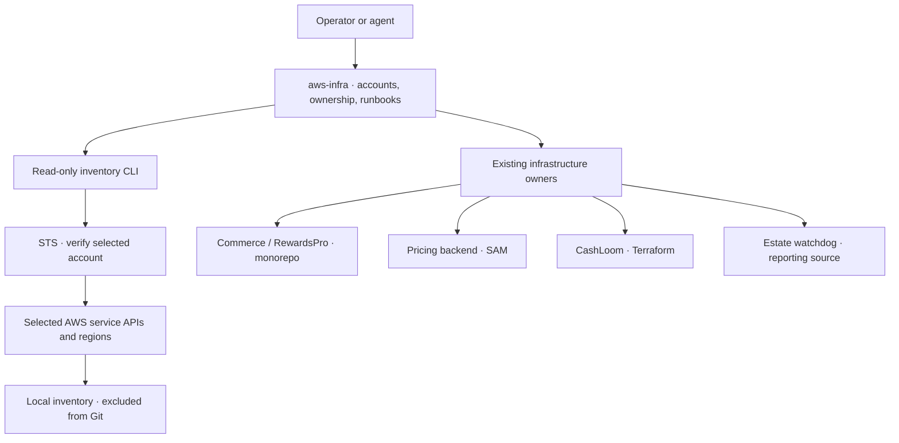

# AWS infrastructure

A shared home for understanding and operating AWS across the projects in
`cambridgetcg`. This repository is **private**.

It starts with an account registry, a map of existing infrastructure ownership,
a repeatable read-only inventory command, and operating runbooks. Existing
application repositories continue to own their Terraform, SAM and deployment
scripts. New shared infrastructure can be added here when its account, state
and responsibilities are defined.

The [17 September IAM review](docs/IAM_REVIEW_2026-09-17.md) confirms live access
to Cambridge TCG and records the original GitHub role-trust exposure. All five
Captioneer IAM roles were [retired and verified absent](docs/CAPTIONEER_CLEANUP.md)
on 18 September. See
[agent access](docs/AGENT_ACCESS.md) for credential handling and the proposed
separation between discovery, deployment and administration.

The [18 September role map](docs/IAM_ROLE_MAP_2026-09-18.md) covers all 133
remaining roles. The [access rebuild](docs/ACCESS_REBUILD.md) preserves current
applications and prepares read-only agent access with temporary project access.
Its reviewed [foundation template](infrastructure/agent-access/README.md) is not
deployed; named SSO profiles are configured, while sign-in verification and
executor isolation remain to be completed.

## Start here

Requirements: macOS or Linux, Python 3.11+, Git, and AWS CLI v2 for authenticated reads.
Offline plans and tests need no AWS credentials; the tests also use Git.

```sh
make check
python3 scripts/aws_inventory.py accounts
python3 scripts/aws_inventory.py plan --account cambridge-tcg --profile default
```

The plan prints the selected account, regions and read commands without
contacting AWS. Once the AWS session is ready:

```sh
aws login --profile default
python3 scripts/aws_inventory.py identity --profile default
python3 scripts/aws_inventory.py scan --account cambridge-tcg --profile default
```

For an already configured IAM Identity Center profile, use `aws sso login
--profile YOUR_PROFILE` instead. See [access and authentication](docs/ACCESS.md).

Every scan first checks the actual STS account against the chosen registry
entry. A wrong account stops before resource collection. An inaccessible
service is recorded as unavailable, not as an empty account. Inventory output
stays under ignored `inventory/local/`, with private file permissions.

Narrow a scan when useful:

```sh
python3 scripts/aws_inventory.py scan --account rewardspro --profile YOUR_PROFILE \
  --region eu-north-1 --service lambda --service dynamodb --service sqs
```

## What connects to what



## Where things belong

| Path | Purpose |
| --- | --- |
| [config/accounts.json](config/accounts.json) | Named accounts, expected IDs and candidate regions. |
| [config/projects.json](config/projects.json) | Projects, existing source owners and provisional account associations. |
| [docs/OWNERSHIP.md](docs/OWNERSHIP.md) | Human-readable map of what already exists and who changes it. |
| [docs/ACCESS.md](docs/ACCESS.md) | Temporary authentication and collector permissions. |
| [docs/AGENT_ACCESS.md](docs/AGENT_ACCESS.md) | Current credential boundary and proposed agent access tiers. |
| [docs/IAM_ROLE_MAP_2026-09-18.md](docs/IAM_ROLE_MAP_2026-09-18.md) | All 133 remaining roles, owners, configured consumers and gaps. |
| [docs/ACCESS_REBUILD.md](docs/ACCESS_REBUILD.md) | Confirmed migration scope, profiles and isolated agent flow. |
| [docs/IAM_REVIEW_2026-09-17.md](docs/IAM_REVIEW_2026-09-17.md) | Verified IAM findings, priorities and review limits. |
| [docs/CAPTIONEER_CLEANUP.md](docs/CAPTIONEER_CLEANUP.md) | Completed five-role retirement, dependency checks and verification. |
| [policies/](policies/README.md) | Proposed inventory permissions and historical Captioneer policy documents. |
| [docs/OPERATIONS.md](docs/OPERATIONS.md) | Inventory, change, verification and recovery workflow. |
| [docs/STATUS.md](docs/STATUS.md) | Dated observations and outstanding setup. |
| [infrastructure/](infrastructure/README.md) | Boundary for shared stacks adopted into this repository. |
| [infrastructure/agent-access/](infrastructure/agent-access/README.md) | Validated, undeployed Identity Center foundation and profile example. |
| `scripts/aws_inventory.py` | Account verification, offline plans and metadata collection. |
| `tests/` | Offline tests for account selection, output and failure handling. |
| `inventory/local/` | Generated private reports; never committed. |

## Coverage and limits

The collector covers selected EC2 instance/VPC metadata, Lambda functions, RDS
instances, ECS clusters, DynamoDB tables, SQS queues, CloudFormation stack
summaries and global S3 bucket names. AWS CLI pagination remains enabled.
It does not enumerate every AWS service, every region, billing, or effective IAM
permissions. Saved reports exclude application configuration and secret fields.
Some APIs, especially Lambda listing, can return environment configuration to
the CLI before local filtering; see the [permission analysis](policies/README.md).
Output filtering is not an IAM restriction. Collection failures and unscanned
scope are part of the report.

Cambridge TCG's identity and selected `us-east-1` metadata plus global S3 names
were verified after login renewal on 17 September 2026. RewardsPro remains
unverified. Source/state ownership and other regions are not established by that
scan. The initial expired-session observation is superseded by [current status](docs/STATUS.md).
RewardsPro has conflicting historical region references, so its defaults
include `eu-west-2`, `eu-north-1` and `us-east-1` pending verification of the
separate v2 and legacy stacks and their actual account ownership.

CI runs tests and repository checks without AWS credentials. Creating or
pushing this repository provisions no AWS resources and starts no scheduled job.
