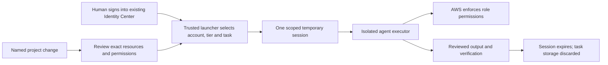

# AWS access rebuild — deployed 18 September 2026

**Two scoped agent roles have been added; all 133 preexisting roles were
preserved.** Cambridge TCG now has 135 IAM roles. The [role map](IAM_ROLE_MAP_2026-09-18.md)
records the historical 133-role baseline before these two additions. Any further
retirement needs a specific consumer migration and ownership review.

The user confirmed **preserve current applications, read-only agent access by
default, and temporary access to named projects when changes are needed**.
The `aws-infra-agent-access` stack was deployed and verified at **17:17:45 UTC**.
It created two permission sets and two assignments to the same existing `USER`,
whose identity was matched to the signed-in SSO administrator. Principal IDs
remain private. SSO device-code authorization succeeded, and both restricted
profiles passed live checks by **17:18:32 UTC**. The existing `default` login,
applications and all 133 prior role configurations and session ceilings were
preserved. Captioneer's five-role retirement remains complete.

## What exists

The baseline IAM/Identity Center audit completed at **14:26 UTC**, with 140 checks
succeeding. Role-to-workload references use the separately dated **12:49 UTC**
17-region scan; they are evidence of configured consumers, not a new deletion gate.

| Exclusive ownership class | Roles | Treatment |
| --- | ---: | --- |
| AWS service-linked | 19 | Manage through their owning AWS services; preserve during access rebuild. |
| Identity Center generated, before this deployment | 3 | Manage permission sets/assignments through Identity Center. |
| CloudFormation owned | 50 | Change through the owning stacks after workload migration. |
| State/source ownership not fully reconciled | 61 | Establish owner and consumers before changing or retiring. |

This table describes the preserved 133-role baseline. The deployed inventory
and IAM audit tiers add two Identity Center generated roles, bringing that
category to five and the account total to 135.

55 roles have selected configured consumer references. 83 have such references
or direct CloudFormation ownership; including service-linked and Identity Center
roles brings the preservation set to 105. The other **28 are unresolved**, not
proven unused. Names, old last-use timestamps and an empty selected scan do not
establish safe deletion.

Existing human access is IAM user `YuCheung` through `aws login`. Identity Center
also exists in `us-east-1`: AdministratorAccess sessions are 8 hours; PowerUser
and ReadOnly sessions are 12 hours. The existing `default` login is preserved
alongside the three newly configured SSO profiles. AWS IAM roles, Identity Center permission sets and local CLI profiles
are different things; deleting a workload role does not rebuild a local profile.

## The new flow

The trusted issuer keeps the human SSO refresh token and broader profiles. From
that issuer, the executor receives only the selected temporary role credentials
and expiration; the runtime launcher adds reviewed task inputs and its separate
subscription login. It cannot request arbitrary role ARNs or run arbitrary commands on
the human host. Its session is not automatically renewed. Selecting a different
profile inside today's unrestricted host chat does not create this boundary.

| Profile on the trusted launcher | Purpose | Status |
| --- | --- | --- |
| `cambridge-human-admin` | Existing SSO AdministratorAccess, selected for human administration | SSO sign-in and intended existing USER identity verified. |
| `cambridge-agent-inventory` | `AWSInfraInventory`: eight discovery actions, one-hour credentials | Provisioned, assigned and live profile checks passed. Routine discovery default. |
| `cambridge-iam-audit` | `AWSInfraIAMAudit`: 34 IAM metadata actions, one-hour credentials | Provisioned, assigned and live profile checks passed. Select for an explicitly requested IAM review. |
| Project deployment | Exact project/environment resources and required role passing | Define after a project and its deployment owner are selected. No generic administrator fallback. |

The [additive foundation](../infrastructure/agent-access/README.md) contains the
complete permission documents, required assignments, account/region restriction,
[profile example](../infrastructure/agent-access/aws-config.example), verification
steps and recovery procedure. Inventory excludes Lambda listing because that API
can return environment values. IAM audit includes identity and policy metadata,
not Identity Center/Organizations/CloudTrail/Access Analyzer APIs. Neither tier
is an exhaustive estate audit or a guarantee that user-entered metadata contains
no sensitive content. Both explicitly deny actions outside their tier, with
`sts:GetCallerIdentity` excepted so the caller can be checked.

Live checks used temporary `ASIA` credentials with 3,598 seconds remaining at
export, matched the exact generated role ARN and immutable role ID, and repeated
STS after the probes. Inventory could describe four VPCs in `us-east-1` and was
denied IAM role listing. IAM audit could list 135 roles and was denied VPC
discovery. These sampled reads verified the profile separation; they do not
establish runtime isolation or test every effective permission.

At **17:19:40 UTC**, the restricted inventory profile also completed all eight
selected collector reads: seven regional collections in `us-east-1` and global
S3 bucket listing. Lambda was explicitly excluded. Other regions, services and
application data remain outside that scan.

A one-hour permission-set session limits the role credentials, not an SSO cache's
ability to obtain new credentials. Do not copy that cache into the executor.
The broker must verify the **exact account and generated role**, plus expiration,
before delivering a session. `aws configure export-credentials` must never be
run against `default` as a convenience fallback, or have its credential output
printed into prompts/transcripts. Verification held the two scoped sessions in
memory and recorded only status, counts and expiry; it did not write or print
credentials. Their recorded expirations were 18:18:15 and 18:18:24 UTC, respectively.
[AWS credential export](https://docs.aws.amazon.com/cli/latest/reference/configure/export-credentials.html),
[SSO role credentials](https://docs.aws.amazon.com/singlesignon/latest/PortalAPIReference/API_GetRoleCredentials.html).

## Runtime choice

The user selected **this Mac** for the isolated runtime. On 18 September at
18:42 UTC, the locked standard account and its 14 staged files passed exact
identity, ownership and hash checks. A real UID 502 process could run the
launcher dependencies and could neither read nor traverse the human home.
The dedicated Colima VM started at 18:43 UTC. Its full isolation checks and
container setup remain pending; VM startup does not activate agent access. The
[executor bundle](../infrastructure/agent-executor/README.md) implements the
trusted issuer, separate launcher and whole Codex process described here. It
defaults to inventory, pins the generated role's account/name/immutable ID,
rejects persistent credentials and ends before expiration. Its offline tests
cover credential/identity rejection, archive handling, bounded I/O and container
controls. The image and network have not been built or exercised; the bundle is
prepared, not active. The successful host-profile checks do not activate it.
Named-project write access remains a per-project follow-up.

Model access uses the owner's **Codex subscription**, with a fresh login in the
dedicated runtime and private token-refresh persistence. The AWS issuer passes
only AWS credentials. No API key or existing human Codex login is copied. See
[subscription authentication](../infrastructure/agent-executor/subscription-auth.md).
Subscription tokens have their own lifetime; the AWS session's one-hour expiry
does not revoke the model login.

Use a whole executor under a separate standard OS account on this Mac with
no access to the human home, login caches, keychain, SSH agent or host-control
sockets. A container can add restrictions, but a host agent retaining arbitrary
shell/Docker access remains a trusted administrator outside that boundary.

This Mac has Docker CLI 29.1.5, Colima 0.9.1 and Lima 2.0.3. Only the new
`aws-agent` profile was started; the human's existing profiles were preserved.
**Installed Colima 0.9.1 turns an empty/null mount list into a writable
home mount.** A dedicated profile needs an explicit nonempty task-only mount
list, and its automatically added read-only Colima cache also needs review.
Verify actual guest mounts before supplying credentials.
[Installed-version implementation](https://github.com/abiosoft/colima/blob/v0.9.1/environment/vm/lima/yaml.go#L333),
[Docker bind mounts](https://docs.docker.com/engine/storage/bind-mounts/).

For each task, use a reviewed image, non-root process, read-only root filesystem,
limited scratch storage, no privileged capabilities, no Docker/SSH sockets and
no host credential mounts. Supply a single `task` profile in private scratch
storage through an unlogged pipe. Use a clean environment, disable instance
metadata credentials and exclude other credential providers. Restrict network
access to required AWS/model endpoints and test that host/private services are
unreachable. Ordinary Docker networking alone is not an endpoint allowlist.
Scratch memory can swap to disk; do not claim that tmpfs guarantees no persistence.
[Docker run controls](https://docs.docker.com/reference/cli/docker/container/run/),
[tmpfs limits](https://docs.docker.com/engine/storage/tmpfs/).

Installed Codex is 0.154.0. Current permission profiles support filesystem deny
rules, but existing `sandbox_mode` settings can override them. Domain rules need
an active network proxy. Those profiles govern sandboxed local commands; MCP,
browser, connectors and other host-control surfaces have separate controls.
A Codex configuration change alone would not isolate unrestricted OpenClaw under
the same OS user. This review used the OpenAI Docs skill; no Codex or OpenClaw
configuration was changed. [Official OpenAI permissions documentation](https://learn.chatgpt.com/docs/permissions).

## Migration order

1. **Complete:** authorize the CLI using SSO device code and match the signed-in
   administrator to the intended existing directory USER. The three local
   profiles use the owner's supplied portal URL.
2. **Complete:** deploy the reviewed additive foundation, verify its four
   resources and assignments, preserve all 133 preexisting roles, and test both
   restricted profiles with allowed and denied metadata reads.
3. Build and verify the isolated executor using only its task session: correct
   role/account, allowed reads, denied out-of-scope access, no human cache or
   host-control access, and expiry without refresh.
4. Select each project's deployment owner, environment, resources and state
   backend. Add a separate narrow deployment identity and test its real workflow.
5. Migrate observed consumers through their owning stacks. Only then prepare
   exact-role retirement records, backup definitions and delete verified unused
   identities. Preserve AWS service-linked and SSO-managed ownership semantics.

The remaining `cardforum-dev-cicd-secrets` role trusts any GitHub owner with a
repository named `cardforum`. Its boundary currently has only deny statements,
so its inline grants do not demonstrate usable identity-based access. Repairing
that boundary without fixing trust could change its exposure. Treat it as a
separate source-owned change, not evidence that all IAM roles should be reset.
[Boundary evaluation](https://docs.aws.amazon.com/IAM/latest/UserGuide/access_policies_boundaries.html).

Private evidence is retained under ignored `inventory/local/`:

- Baseline: `20260918T142601.699306Z-iam-roles-identity-center.json`.
- Deployment: `20260918T171745.172227Z-agent-access-execution.json`.
- Profile checks: `20260918T171832.669636Z-agent-profile-verification.json`.
- Restricted inventory: `20260918T171940.627853Z-cambridge-tcg.json`.

Raw responses, principal IDs, credentials and provider caches are excluded from
this published record. The separate historical RewardsPro account remains
unverified; its legacy IAM/Lambda references were observed in Cambridge TCG.
The deployed access stack is limited to Cambridge TCG.
