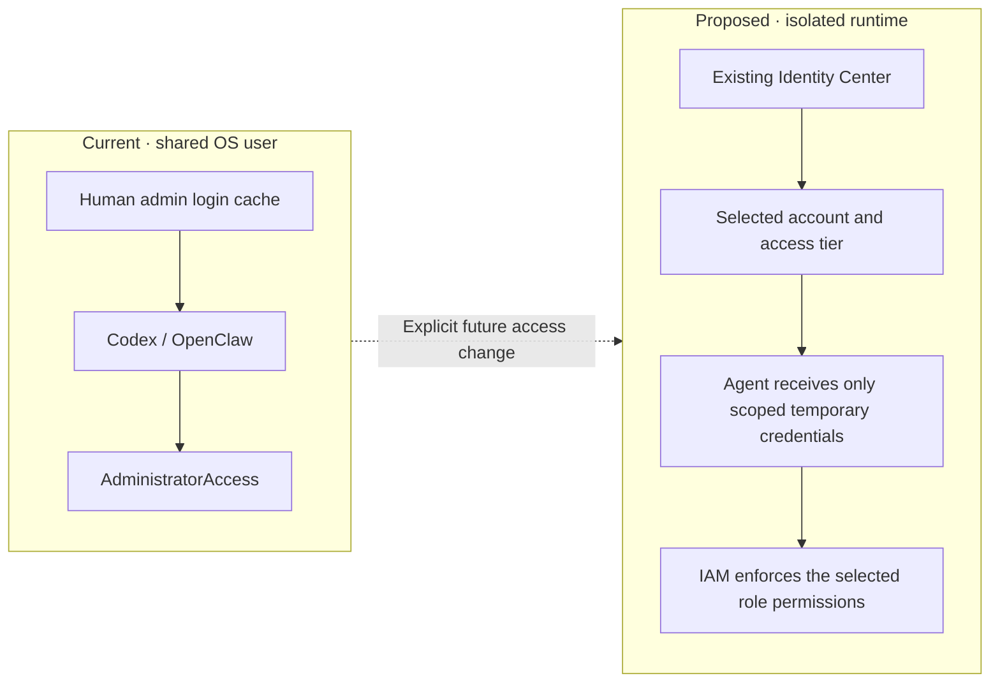

# Agent access: live tiers and runtime boundary

**Reviewed 17 September 2026.** This document proposes how agents should receive
AWS access. That review changed no roles, policies, assignments, keys or session settings.
Detailed observations belong in [the IAM review](IAM_REVIEW_2026-09-17.md).
That original review was read-only. Subsequent [Captioneer cleanup](CAPTIONEER_CLEANUP.md)
quarantined two deployment roles on 17 September and retired all five Captioneer
roles on 18 September. It did not implement the agent-access model here. The
renewed human administrator login was verified again for that cleanup.

**18 September rebuild:** the user chose to preserve current applications, use
read-only agent access by default and grant temporary access to named projects
for changes. The [role map](IAM_ROLE_MAP_2026-09-18.md) and
[concrete access proposal](ACCESS_REBUILD.md) extend this review. The new
local profiles are authenticated. The two permission sets and assignments were
deployed at 17:17 UTC; live one-hour credential, identity and allow/deny checks
passed at 17:18 UTC. All 133 existing roles were preserved; two new SSO roles
bring the total to 135. The [executor bundle](../infrastructure/agent-executor/README.md)
remains inactive pending the dedicated Mac runtime and live isolation checks.

## What agents can reach today

The local `default` profile uses `aws login`, region `us-east-1`, and currently
resolves to IAM user `YuCheung` in Cambridge account `034362054546`.
`AdministratorAccess` is attached and no permissions boundary was observed.
Temporary login credentials retain the selected identity's permission scope;
their expiry does not make an administrator session read-only.
[AWS login](https://docs.aws.amazon.com/cli/latest/reference/login/),
[temporary credentials](https://docs.aws.amazon.com/IAM/latest/UserGuide/id_credentials_temp_use-resources.html).

The local audit found `~/.aws/config` and login-cache JSON files at mode `0600`,
cache directories at `0755`, and no `~/.aws/credentials` file. These observations
do not establish isolation between processes sharing the same OS user.
Unrestricted Codex and OpenClaw processes running under that user can access the
human login configuration and cache. No separate per-agent credential boundary
was established. No credential values are reproduced here.

**Selecting a narrower profile alone cannot isolate an agent that can still read
the administrator cache.** It selects credentials for that invocation; it does
not revoke access to other profiles or files. The collector's read-only command
list likewise does not restrict what another command can do with those credentials.

Other identities exist, but are not the current local login:

| Observation | Meaning |
| --- | --- |
| Existing IAM Identity Center in `us-east-1` | Reuse this access system; a duplicate setup is unnecessary. Observed permission-set sessions: Admin **8 hours**, PowerUser and ReadOnly **12 hours**. Generated roles' 12-hour maximum is a separate setting. |
| `alpha-agent` IAM user | Both observed access keys are inactive. |
| `openclaw-agent` IAM user | One active key, created 17 March 2026; last recorded use was STS on 21 August. It is not configured as the local `default` credential. |
| `openclaw-agent` policy | Includes EC2 start/stop/reboot, security-group ingress changes and Elastic IP allocation/association, with resource `*` and no region conditions, plus self-IAM reads and STS. This is not an inventory-only identity. |
| `YuCheung` MFA-device listing | No attached IAM MFA device observed. This query does not establish the authentication context of the particular `aws login` event. |

[ListMFADevices](https://docs.aws.amazon.com/cli/latest/reference/iam/list-mfa-devices.html)
enumerates devices associated with an IAM user, not session authentication history.
An active key's last-used record also does not identify which local process holds it.

Cambridge is the **organization management account**. SCPs do not constrain its
users or roles, and RCPs do not constrain resources owned by it. Do not count
organization guardrails as protection for this administrator session. An RCP on
a member-account resource can still affect access to that resource.
[SCP scope](https://docs.aws.amazon.com/organizations/latest/userguide/orgs_manage_policies_scps.html),
[RCP scope](https://docs.aws.amazon.com/organizations/latest/userguide/orgs_manage_policies_rcps.html).

## Access tiers

The deployed foundation uses the existing Identity Center with explicit
account/role profiles and purpose-specific permissions. Inventory and IAM audit
now use **60-minute sessions**, verified with real temporary credentials.
Existing Admin, PowerUser and ReadOnly settings remain unchanged.

| Tier | Intended scope |
| --- | --- |
| **Inventory — live** | Eight resource-enumeration actions. No Lambda configuration, IAM audit, deployment, data access or role assumption. |
| **IAM audit — live** | 34 IAM identity/policy/trust metadata reads. Identity Center assignments, Organizations and CloudTrail are outside this tier. |
| **Project deployment** | Named project/environment resources, deployment/state access, and only required role passing. Limit `iam:PassRole` to intended runtime roles and services; exclude general IAM/organization administration. |
| **IAM administration** | Separate privileged session for a named access change. It is not the default agent profile or an implicit dependency of deployment. |

Profiles can bind a shared SSO session to specific account/role assignments, or
use a reviewed target role and source profile. Verify actual STS identity before
an account-scoped operation. [Identity Center profiles](https://docs.aws.amazon.com/cli/latest/userguide/cli-configure-sso.html),
[role profiles](https://docs.aws.amazon.com/cli/latest/userguide/cli-configure-role.html).

Enforcement needs both scoped IAM permissions **and a runtime unable to retrieve
the broader credentials**: for example, a separate OS user or isolated container
with no administrator-cache mount, inherited administrator credentials or access
to a privileged host control socket. Give it only the intended session/provider.
Changing Unix file modes under the same unrestricted UID does not achieve this.
Do not attach a narrow allow policy to an existing administrator and call it a
restriction; broader applicable grants remain. Resource/session policies and
explicit denies also affect effective access.
[AWS policy evaluation](https://docs.aws.amazon.com/IAM/latest/UserGuide/reference_policies_evaluation-logic.html).

## CI, workloads and the inventory policy

**CI:** use a dedicated OIDC role for the exact repository and deployment
environment/branch, with audience `sts.amazonaws.com` and a restrictive subject
condition. Use environment protections appropriate to the existing release
workflow. Keep deployment roles separate from validation and account administration;
do not upload human login caches or store long-lived IAM keys in CI.
[AWS GitHub OIDC guidance](https://docs.aws.amazon.com/IAM/latest/UserGuide/id_roles_create_for-idp_oidc.html).

**Workloads:** use a dedicated Lambda execution role, ECS task role or EC2 instance
role for application needs. ECS task roles provide application permissions;
task execution roles serve the container platform. Neither should inherit a
human deployment identity. [AWS role guidance](https://docs.aws.amazon.com/IAM/latest/UserGuide/best-practices.html),
[ECS roles](https://docs.aws.amazon.com/AmazonECS/latest/developerguide/security-ecs-iam-role-overview.html).

The [inventory policy](../policies/agent-inventory-read.json) is **proposed and
unattached**. Its `lambda:ListFunctions` grant can return `Environment.Variables`
before the CLI filters the response locally. Saved-field projection is not a
guarantee that configuration or secrets never reach the process. For a strict
no-application-configuration requirement, omit the Lambda service from scans
and remove that permission from the proposed role; also check other grants.
[Policy limits](../policies/README.md), [Lambda response schema](https://docs.aws.amazon.com/lambda/latest/api/API_ListFunctions.html).

The [access rebuild](ACCESS_REBUILD.md) records the deployed assignments and
policies. Runtime isolation, project deployment identities and migration of
existing OpenClaw credentials remain separate work. No existing access key was
deactivated by provisioning these two tiers.
