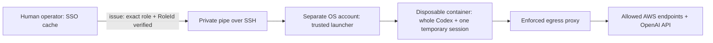

# Isolated agent executor — prepared, inactive

This bundle runs the **whole Codex CLI process** with one temporary AWS session
inside a disposable container. It has not been built, started, or tested against
AWS or a model. The interactive Codex app on Yu's current account remains outside
this boundary; selecting a narrower AWS profile cannot isolate that app from the
human administrator cache.



The launcher accepts only `inventory` (default, profile
`cambridge-agent-inventory`) or `iam-audit` (profile `cambridge-iam-audit`). It
does not accept arbitrary profiles, roles, or administrator fallback. Named
project write access requires a separately reviewed role and launcher change;
it is not available in this bundle.

## Required before activation

1. Provision the reviewed [access foundation](../agent-access/README.md), finish
   human SSO login, and obtain each generated role's exact ARN and immutable
   `RoleId`. Copy `manifest.example.json` into private operator storage and fill
   these values. Place an independently controlled copy on the runtime host.
   Both manifests must be owned by their launcher user, not writable by others,
   and held in directories the container cannot access. The example deliberately
   fails validation. Verify the corresponding policies remain the approved
   restricted policies; matching a role ID does not prove its current permissions.
2. Use a dedicated **standard OS account** or dedicated remote machine for the
   runtime. The launcher refuses root, this Mac's human UID 501, and membership
   in the macOS admin group. Those checks alone do not prove separation: the
   operator must deny access to human homes, AWS/SSO/Codex caches, other users'
   Docker engines, and shared credential services. A remote Linux ARM64 host
   provides a simpler separation from this Mac. Preserve current apps and engines.
3. Build and smoke-test the image below. Supply a separate model API key with an
   appropriate project/budget and select an available model in `task.json`.
   No model key is available from this repository. Never copy human Codex auth.
4. Prepare Docker Engine **server version 28 or newer**, a dedicated internal
   bridge `aws-agent-internal` with
   `com.docker.network.bridge.gateway_mode_ipv4=isolated` and IPv6 disabled, and
   the separately managed proxy `aws-agent-egress`. Only that proxy may initially
   occupy the network. Pin its full container ID, immutable image ID, canonical
   host config path, and SHA-256 config fingerprint under `proxy_identity` in the
   manifest. These values are deliberately unresolved in the example.
   Neither proxy image nor installed config has been verified here.
5. **Enforce and test network isolation before launching an agent.** An internal
   bridge and proxy environment variables alone do not establish isolation.
   The launcher checks isolated gateway mode, binds to the inspected network ID,
   disables IPv6, sets `--dns=127.0.0.1`, and maps `egress` to the verified proxy
   IPv4 address. Still require host/VM firewall or equivalent controls and
   no-credential probes of direct public TCP, gateway/host TCP, private/metadata
   addresses, IPv6, and arbitrary DNS, including UDP/TCP to Docker's embedded
   `127.0.0.11` resolver. They must fail while approved HTTPS through the proxy
   succeeds. The launcher does not execute or attest these operational probes.
   **Activation remains blocked until these checks pass.**

The account's administrator can change policies or role assignments. This
bundle isolates human administrator credentials from the task process; it cannot restrict the human
operator or an administrator controlling the host, Docker daemon, or AWS account.

The proxy must run `/usr/sbin/squid -N -f /etc/squid/squid.conf` directly from its
reviewed image, with read-only root filesystem and no privileged mode. Its only
non-tmpfs mount must bind the reviewed config file read-only to that exact path.
Optional tmpfs storage is limited to `/run`, `/tmp`, `/var/log/squid`,
`/var/spool/squid`, and `/var/cache/squid`. Adapt and test the proxy image to this
contract; this bundle does not supply or start one.
The initial allowlist covers `us-east-1` service endpoints plus global IAM/S3
and OpenAI; reads in other regions require a reviewed endpoint expansion even
where IAM already permits them.

Before each task, the launcher checks those inspected settings and compares the
manifest fingerprint against both the operator-owned host file and the actual
mounted file retrieved by bounded `docker cp`. This also detects a different
file at the daemon's path when Docker runs inside a VM or remotely. These are
checks of current files and configured startup arguments, **not attestation of
the proxy's memory or effective behavior**. Recreate the proxy after config
changes and repeat operational probes. Protect both host directories and the
Docker daemon against task access; the operator remains trusted.

## Build and launch after those prerequisites

The ARM64 Dockerfile pins Python 3.13.11 and AWS CLI 2.33.6 base-image digests and
the Codex 0.154.0 package checksum. Pins were checked against upstream registry
and release metadata; no layers were downloaded and no image was built here.
Build-time version checks still need to verify binary layout and dependencies.

```sh
docker build --platform linux/arm64 -t aws-agent-executor:0.154.0 infrastructure/agent-executor
docker image inspect aws-agent-executor:0.154.0 --format '{{.Id}}'
```

Set the resulting immutable `sha256:…` image ID in the runtime manifest. The
launcher uses `--pull never`. Do not mount host paths, credentials, Docker
sockets, or model auth into the image. On macOS, configure a separate VM/runtime
for the dedicated account; do not assume empty/default Colima mounts hide home.

Create a reviewed, uncompressed input tar (at most 8 MiB/2,000 entries), and a
private `task.json` based on the example. Links, traversal, `.git`, `.aws`,
`.codex`, `.openclaw`, `.ssh`, and `.env*` paths are rejected. Other files can
still contain secrets: review inputs before transfer. Copy only task inputs and
this launcher to the separate account. Existing collector scripts may require
tools or Git state absent from this minimal image; direct AWS CLI reads work
independently of that collector.

Example human-operated handoff, using private paths outside the repository:

```sh
python3 infrastructure/agent-executor/executor.py issue \
  --manifest /private/operator/agent-manifest.json --tier inventory \
  --model-key-fd 4 --handoff-fd 3 \
  4< /private/operator/dedicated-model-key 3>&1 1>/dev/null |
ssh -a -o ForwardAgent=no isolated-runtime \
  'python3 /opt/aws-agent/executor.py run --manifest /private/runtime/agent-manifest.json --tier inventory --task /private/runtime/task.json --archive /private/runtime/input.tar'
```

Use an authenticated, verified SSH host connection. The key-input descriptor may
instead come from a trusted secret manager. Do not put keys in shell arguments,
environment exports, logs, Git, task prompts, or ordinary files in the repository.
The issuer must run outside any agent process that can read the human cache.

`issue` exports the fixed named profile and checks account, exact assumed role,
unique role ID, temporary-key format, and 2–60 minutes remaining before sending
anything. The container repeats STS identity verification. Its AWS config has
one `task` profile, no refresh token or alternate credentials. Codex stops before
expiry; the external launcher also enforces the expiry deadline and removes the
container. AWS keys are not revoked by container removal; they expire normally.

The container uses a non-root UID, read-only root filesystem, dropped
capabilities, resource limits, no-new-privileges, tmpfs task storage, and no host
mounts. Its Codex process uses fresh state, ignores user config and exec rules,
and uses `CODEX_API_KEY` for non-interactive authentication. The outer container
is the enforcement boundary; Codex's inner `danger-full-access` applies there.
The AWS session and model key are intentionally readable by that task process.
Docker tmpfs can use swap; configure the host's storage protections accordingly.

Only a bounded final JSON result is returned; command diagnostics and Docker
logging are suppressed. Literal credential strings are redacted. This is **not
protection against encoded secrets or intentional exfiltration**. Treat results
as untrusted data. The permitted model endpoint necessarily receives task data;
endpoint allowlisting cannot distinguish a legitimate model request from data
sent there by a compromised task. IAM limits, isolated credentials, reviewed
inputs, and the model project's controls remain necessary.

## Offline checks and references

```sh
python3 -B -m unittest discover -s infrastructure/agent-executor -p 'test_*.py' -v
```

Tests use fixtures and short local Python processes only. They do not start
Docker, invoke AWS, load credentials, or contact a model. Container build,
network negative tests, actual authentication, and end-to-end expiry remain
activation checks, not claims made by these unit tests.

- [AWS export-credentials](https://docs.aws.amazon.com/cli/latest/reference/configure/export-credentials.html)
  and [STS GetCallerIdentity](https://docs.aws.amazon.com/STS/latest/APIReference/API_GetCallerIdentity.html).
- [Codex environment variables](https://learn.chatgpt.com/docs/config-file/environment-variables)
  and [0.154.0 release](https://github.com/openai/codex/releases/tag/rust-v0.154.0).
  Local 0.154.0 `exec --help` confirms the three config/rules/ephemeral flags.
- [Docker run controls](https://docs.docker.com/reference/cli/docker/container/run/),
  [isolated gateway mode](https://docs.docker.com/engine/network/port-publishing/#gateway-modes),
  [container DNS](https://docs.docker.com/engine/network/#dns-services),
  [bind-mount host access](https://docs.docker.com/engine/storage/bind-mounts/),
  and [tmpfs limitations](https://docs.docker.com/engine/storage/tmpfs/).
