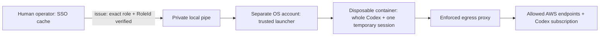

# Isolated agent executor — inventory task verified

This bundle runs the **whole Codex CLI process** with one temporary AWS session
inside a disposable container. On 19 September 2026, refreshed network and
DNS/cleanup checks passed at 08:53:42 UTC, separate subscription login completed
at 08:55:07 UTC, and the maintained `run-task.py` completed its first inventory
task at 08:55:47.967 UTC. Post-task inspection at 08:55:48 UTC confirmed valid
local authentication schema, no submitted task directories or task containers,
and the sole pinned proxy. The interactive Codex app on Yu's current account remains outside
this boundary; selecting a narrower AWS profile cannot isolate that app from the
human administrator cache.

The [local Mac setup](setup-local.md) has a verified, locked standard account
and a running separate Colima profile, with a local credential pipe and no host
SSH server. Docker Engine 28.4.0 runs the verified images. See the
[Mac agent flow](../../docs/MAC_AGENT_FLOW.md) for the operator workflow.
The inventory flow is live-verified. The separate fixed smoke helper and an
isolated IAM-audit task were not live-tested. The trusted result matched the
pinned inventory role; the model reported four VPCs and expected IAM denial.
See [result evidence and limits](../../docs/STATUS.md).



The launcher accepts only `inventory` (default, profile
`cambridge-agent-inventory`) or `iam-audit` (profile `cambridge-iam-audit`). It
does not accept arbitrary profiles, roles, or administrator fallback. Named
project write access requires a separately reviewed role and launcher change;
it is not available in this bundle.

## Required runtime controls

1. The reviewed [access foundation](../agent-access/README.md) is deployed,
   human SSO login succeeded, and each generated role's exact ARN and immutable
   `RoleId` was verified. Copy `manifest.example.json` into private operator storage and fill
   these values. Place an independently controlled copy on the runtime host.
   Both manifests must be owned by their launcher user, not writable by others,
   and held in directories the container cannot access. The example deliberately
   fails validation. Verify the corresponding policies remain the approved
   restricted policies; matching a role ID does not prove its current permissions.
2. Use a dedicated **standard OS account** or dedicated remote machine for the
   runtime. The launcher refuses root, this Mac's human UID 501, and membership
   in the macOS admin group. Those checks alone do not prove separation: the
   operator must deny access to human homes, AWS/SSO/Codex caches, other users'
   Docker engines, and shared credential services. The user selected this Mac's
   dedicated account and VM. Preserve current apps and engines.
3. Build and smoke-test the image below. The user selected **Codex subscription
   access**. Complete a fresh device-code login under the dedicated runtime
   account, then select an available model in `task.json`. Keep its authentication
   file in private operator storage outside the task. Never copy the human's
   existing Codex cache or use an inherited API key.
   See [subscription authentication](subscription-auth.md) for login and refresh ownership.
4. Prepare Docker Engine **server version 28 or newer**, a dedicated internal
   bridge `aws-agent-internal` with
   `com.docker.network.bridge.gateway_mode_ipv4=isolated` and IPv6 disabled, and
   the separately managed proxy `aws-agent-egress`. Only that proxy may initially
   occupy the network. Pin its full container ID, immutable image ID, canonical
   host config path, and SHA-256 config fingerprint under `proxy_identity` in the
   manifest. These values are deliberately unresolved in the example.
   The proxy configuration, running metadata and current network behavior have
   passed the credential-free checks recorded above.
5. **Enforce and test network isolation before launching an agent.** An internal
   bridge and proxy environment variables alone do not establish isolation.
   The launcher checks isolated gateway mode, binds to the inspected network ID,
   disables IPv6, sets `--dns=127.0.0.1`, and maps `egress` to the verified proxy
   IPv4 address. Still require host/VM firewall or equivalent controls and
   no-credential probes of direct public TCP, gateway/host TCP, private/metadata
   addresses, IPv6, and arbitrary DNS, including UDP/TCP to Docker's embedded
   `127.0.0.11` resolver. They must fail while approved HTTPS through the proxy
   succeeds. The launcher does not execute or attest these operational probes.
   These network checks passed for the current image/configuration; repeat them
   after changes. Subscription and inventory-task verification passed on
   19 September; matching proofs are required for routine submissions.

The account's administrator can change policies or role assignments. This
bundle isolates human administrator credentials from the task process; it cannot restrict the human
operator or an administrator controlling the host, Docker daemon, or AWS account.

The proxy must run `/usr/sbin/squid -N -f /etc/squid/squid.conf` directly from its
reviewed image, with read-only root filesystem and no privileged mode. Its only
non-tmpfs mount must bind the reviewed config file read-only to that exact path.
Optional tmpfs storage is limited to `/run`, `/tmp`, `/var/log/squid`,
`/var/spool/squid`, and `/var/cache/squid`. Adapt and test the proxy image to this
contract; the [pinned proxy recipe](proxy-runtime.md) supplies the reviewed image
definition and startup procedure. The current proxy is built, running and tested.
The initial allowlist covers `us-east-1` service endpoints plus global IAM/S3
and OpenAI; reads in other regions require a reviewed endpoint expansion even
where IAM already permits them.

Before each task, the launcher checks those inspected settings and compares the
manifest fingerprint against both the operator-owned host file and the actual
mounted file retrieved by bounded `docker cp`. This also detects a different
file at the daemon's path when Docker runs inside a VM or remotely. These are
checks of current files and configured startup arguments, **not attestation of
the proxy's memory or effective behavior**. Recreate the proxy after config
changes and repeat operational probes. Protect both host directories and the
Docker daemon against task access; the operator remains trusted.

## Build and launch after those prerequisites

The ARM64 Dockerfile pins Python 3.13.11 and AWS CLI 2.33.6 base-image digests and
the Codex 0.154.0 package checksum. Pins were checked against upstream registry
and release metadata. Live checks verified Python 3.13.11, AWS CLI 2.33.6,
Codex 0.154.0 and Squid 7.2. The Dockerfile explicitly copies both Python scripts
as mode 0444, and UID 10001 successfully read, compiled and ran their `--help`.
The IPv6 probe requires every interface disabled, no IPv6 addresses and no active
IPv6 routes before treating `EADDRNOTAVAIL` as evidence of disabled IPv6.

The verified executor image is
`sha256:3e16293cbcf1e3e27f509303f843738901b1fe616e73a986c97390fe991aecb8`.
Its probe source matches the repository SHA-256
`aac3392c63566f8c1d6affa767be3fa53d8310a36e3a93d39258f53966db1282`.
Detailed source, image and manifest-before/after receipts remain private; the
original staged bundle and proxy were preserved during the image repairs.

```sh
docker build --platform linux/arm64 -t aws-agent-executor:0.154.0 infrastructure/agent-executor
docker image inspect aws-agent-executor:0.154.0 --format '{{.Id}}'
```

Set the resulting immutable `sha256:…` image ID in the runtime manifest. The
launcher uses `--pull never`. Do not mount host paths, credentials, Docker
sockets, or model auth into the image. On macOS, configure a separate VM/runtime
for the dedicated account; do not assume empty/default Colima mounts hide home.

Create a reviewed, uncompressed input tar (at most 8 MiB/2,000 entries), and a
private `task.json` based on the example. Links, traversal, `.git`, `.aws`,
`.codex`, `.openclaw`, `.ssh`, and `.env*` paths are rejected. Other files can
still contain secrets: review inputs before transfer. Copy only task inputs and
this launcher to the separate account. Existing collector scripts may require
tools or Git state absent from this minimal image; direct AWS CLI reads work
independently of that collector.

Example handoff to a separately prepared remote runtime, using private paths
outside the repository. For the selected local Mac use [setup-local.md](setup-local.md):

```sh
python3 infrastructure/agent-executor/executor.py issue \
  --manifest /private/operator/agent-manifest.json --tier inventory \
  --handoff-fd 3 3>&1 1>/dev/null |
ssh -a -o ForwardAgent=no isolated-runtime \
  'python3 /opt/aws-agent/executor.py run --manifest /private/runtime/agent-manifest.json --tier inventory --model-auth /private/runtime/subscription/auth.json --task /private/runtime/task.json --archive /private/runtime/input.tar'
```

Use an authenticated, verified SSH host connection. Do not put credentials in
shell arguments, environment exports, logs, Git, task prompts, or ordinary files
in the repository. The AWS handoff contains no model authentication.
The issuer must run outside any agent process that can read the human cache.

`issue` exports the fixed named profile and checks account, exact assumed role,
unique role ID, temporary-key format, and 2–60 minutes remaining before sending
anything. The container repeats STS identity verification. Its AWS config has
one `task` profile, no refresh token or alternate credentials. Codex stops before
expiry; the external launcher also enforces the expiry deadline and removes the
container. AWS keys are not revoked by container removal; they expire normally.

The container uses a non-root UID, read-only root filesystem, dropped
capabilities, resource limits, no-new-privileges, tmpfs task storage, and no host
mounts. Its Codex process uses fresh state, ignores user config and exec rules,
and forces ChatGPT authentication using its fresh runtime subscription login.
The outer container
is the enforcement boundary; Codex's inner `danger-full-access` applies there.
The AWS session and subscription tokens are intentionally readable by that task
process. Subscription tokens can refresh and outlive the AWS session; their
scope and lifetime are separate from the one-hour AWS boundary. The launcher
persists updated subscription auth privately after a validated successful task.
A failed or interrupted handoff requires a fresh login, avoiding reuse of a
potentially stale refresh token.
Docker tmpfs can use swap; configure the host's storage protections accordingly.

Only a bounded final JSON result is returned; command diagnostics and Docker
logging are suppressed. Literal credential strings are redacted. This is **not
protection against encoded secrets or intentional exfiltration**. Treat results
as untrusted data. The permitted model endpoint necessarily receives task data;
endpoint allowlisting cannot distinguish a legitimate model request from data
sent there by a compromised task. IAM limits, isolated credentials, reviewed
inputs, and the subscription account's controls remain necessary.

## Offline checks and references

Before credential handoff, the separate runtime user can run:

```sh
python3 executor.py probe --manifest /private/runtime/agent-manifest.json \
  --probe-config /private/runtime/network-probe.json
```

The private probe config contains `proxy_ipv4` and five `{name, ip, port}` targets
named `host`, `private`, `metadata`, `public` and `ipv6`; use inspected actual
host/VM addresses and reviewed test destinations. The
[probe source](probe_network.py) documents the exact constraints. The launcher
checks the proxy, uses the same image/network/container controls as a task, and
passes this config through stdin without a host mount or credential envelope.
The verified local image includes the reviewed probe, and all 28 checks passed.

The 28 runtime checks cover allowed HTTPS endpoints, explicit proxy denials,
direct-path kernel/route evidence and unchanged network configuration. Timeouts
or refused connections are inconclusive. Save the report privately. A successful
network-check exit **does not mean activation is ready**: DNS observation,
external cleanup and actual AWS identity/permission checks are separate. DNS
observation now passed with zero drops/errors, real UDP controls and synthetic
checksummed TCP packet controls captured on `eth0` before/after all six negative
socket-query attempts; no negative nonce was observed. Synthetic TCP controls
calibrate capture, not a successful TCP DNS transaction or universal escape
prevention. A termination-resistant dummy was removed after 10.174 seconds on
18 September; refreshed DNS/cleanup checks passed on 19 September. The inventory
task and normal cleanup passed, but AWS expiry and abrupt launcher death remain
untested. `run` does not automatically execute or attest these probes.

```sh
python3 -B -m unittest discover -s infrastructure/agent-executor -p 'test_*.py' -v
```

Tests use fixtures and short local Python processes only. They do not start
Docker, invoke AWS, load credentials, or contact a model. Container build,
network negative tests, actual authentication, and end-to-end expiry remain
activation checks, not claims made by these unit tests.

- [AWS export-credentials](https://docs.aws.amazon.com/cli/latest/reference/configure/export-credentials.html)
  and [STS GetCallerIdentity](https://docs.aws.amazon.com/STS/latest/APIReference/API_GetCallerIdentity.html).
- [Codex environment variables](https://learn.chatgpt.com/docs/config-file/environment-variables)
  and [subscription authentication](https://learn.chatgpt.com/docs/auth)
  and [0.154.0 release](https://github.com/openai/codex/releases/tag/rust-v0.154.0).
  Local 0.154.0 `exec --help` confirms the three config/rules/ephemeral flags.
- [Docker run controls](https://docs.docker.com/reference/cli/docker/container/run/),
  [isolated gateway mode](https://docs.docker.com/engine/network/port-publishing/#gateway-modes),
  [container DNS](https://docs.docker.com/engine/network/#dns-services),
  [bind-mount host access](https://docs.docker.com/engine/storage/bind-mounts/),
  and [tmpfs limitations](https://docs.docker.com/engine/storage/tmpfs/).
